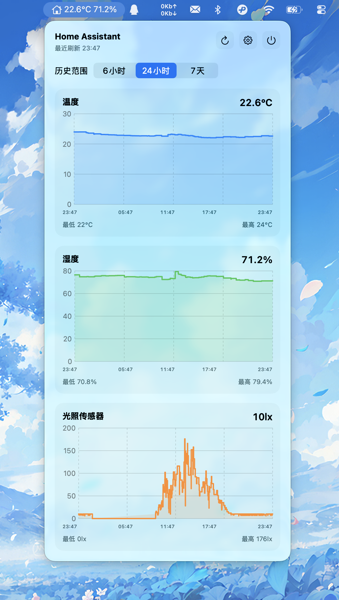

# HABar

一个基于 SwiftUI 的 macOS 菜单栏应用，用来连接 Home Assistant 并显示传感器信息。



## 功能

- 在菜单栏显示 1 到 3 个传感器当前值
- 点击菜单栏图标查看 1 到 4 个传感器历史图表
- 支持 `6小时`、`24小时`、`7天` 时间范围
- 支持为每个图表配置不同颜色
- 支持开机自启动

## 使用方式

1. 打开应用。
2. 在设置中填写 Home Assistant 地址和 Long-Lived Access Token。
3. 选择菜单栏要显示的传感器。
4. 选择卡片界面要显示的图表传感器。

## 构建

在项目目录执行：

```bash
env DEVELOPER_DIR=/Applications/Xcode-26.3.0.app/Contents/Developer xcodebuild -configuration Release -scheme HABar -derivedDataPath /tmp/HABarDerived build
```

构建产物示例：

```text
/tmp/HABarDerived/Build/Products/Release/HABar.app
```

## 内存与后台刷新

- 设置页共用一个支持名称和实体 ID 搜索的传感器列表，打开时创建，滚动时按需创建行。
- 设置窗口隐藏时释放表单，保留已保存的连接和传感器配置。
- 菜单栏当前值仍每 60 秒更新；只有图表面板显示时才请求历史。
- 面板隐藏时取消历史请求、清空历史并移除图表视图；重新打开时加载最新历史。
- 历史请求失败独立显示，不影响当前值的连接状态；切换范围和传感器会取消旧请求。

自动检查（需要 macOS 和 Swift 编译器，会短暂显示测试窗口；使用模拟响应）：

```bash
Tests/run.sh
```

2026-10-23 在 macOS 27.0.1 上用 Release 构建、227 个模拟传感器和 4 张图表测试：
仅菜单栏启动约 19 MiB；独立窗口测试中设置约 36 MiB，选择列表约 40 MiB，
图表打开约 99 MiB，连续开关五轮后约 59 MiB。后者使用原生窗口测试宿主，
与实际 Home Assistant 的完整使用过程并不等价，不能直接据此计算相对旧版本的降幅。
50 MiB 可作为后台目标，目前不能保证打开图表或使用图表后始终低于这一数值。

## 安装包

当前仓库里已经生成了一个 DMG：

```text
/Users/umi/Documents/HABar/HABar.dmg
```
